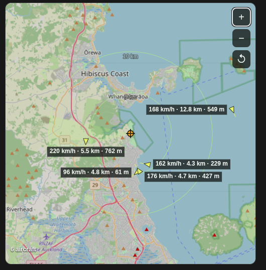
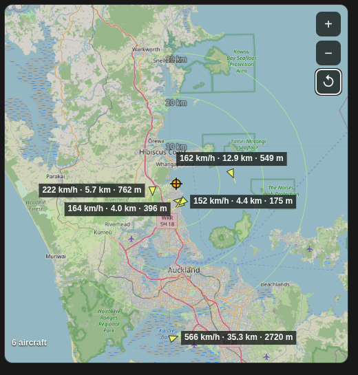

# tar1090 cards

One JavaScript file registers two Home Assistant dashboard cards. Both read `aircraft.json` and `receiver.json` from tar1090 in the browser. They do not use the MQTT bridge. The bridge still publishes the summary sensors. For those sensors, check out [tar1090-ha-bridge](https://github.com/Deishelon/tar1090-ha-bridge).

Your tar1090 data URL already sends `Access-Control-Allow-Origin: *`, so a browser on another host can read it.

## Install

Copy `tar1090-radar-card.js` into Home Assistant's `www` folder:

```text
config/www/tar1090-radar-card/tar1090-radar-card.js
```

On Home Assistant OS that folder is `/config/www`. It is served as `/local/`.

Add a Lovelace resource. Settings → Dashboards → three dots → Resources → Add resource:

- URL: `/local/tar1090-radar-card/tar1090-radar-card.js?v=1`
- Type: JavaScript module

Reload the dashboard. Add a card with YAML. There is no visual editor. One resource registers both card types.

After you change the JavaScript file, increase `?v=1` to `?v=2` so the browser fetches the new file.

The browser must be able to reach `base_url`. A phone on your LAN can. A remote Home Assistant session can only if that URL is reachable from the phone.

`base_url` is the directory that contains `aircraft.json` and `receiver.json`. No trailing filename.

## Radar card

`custom:tar1090-radar-card` draws a normal map, then a radar overlay on top: range rings, your receiver, and each aircraft from tar1090. Drag to pan. The origin stays on its real position while the map moves. Zoom with the + and − buttons.

By default the card zooms to the furthest aircraft and follows it as the aircraft move. A plane that starts far away zooms the map out only far enough to keep that plane on screen. As it comes closer, the map zooms back in. That stops while you pan or zoom, and starts again after ↺ or the idle reset. `auto_zoom: false` keeps `initial_zoom` until you change it yourself.

Aircraft labels move around the icon when they would cover each other. If there is still no gap, the label drops to the callsign, or to the speed alone.

Each range ring has a faint distance on it. The distances follow the zoom: closer when you zoom in, farther when you zoom out. The rings stay about the same size on the card. `range_km` is the furthest the outer ring is allowed to grow.

| Zoomed in                                                                      | Zoomed out                                                                      |
|--------------------------------------------------------------------------------|---------------------------------------------------------------------------------|
|  |  |

### Examples

```yaml
type: custom:tar1090-radar-card
base_url: https://example.com/tar1090/data
height: 460
```

Distance labels off, speed and callsign on, rings never larger than 80 km, wheel zoom enabled:

```yaml
type: custom:tar1090-radar-card
base_url: https://example.com/tar1090/data
height: 520
show_distance: false
show_speed: true
show_callsign: true
show_altitude: true
range_km: 80
ring_count: 4
scroll_zoom: true
```

Pure radar, no street map:

```yaml
type: custom:tar1090-radar-card
base_url: https://example.com/tar1090/data
show_map: false
show_sweep: true
show_crosshair: true
```

### Receiver position

The origin is `lat` and `lon` from `receiver.json`. The card uses that when the file has a position.

`latitude` and `longitude` in the card YAML are used only when `receiver.json` has no position. They do not override the API.

Aircraft distance uses readsb `r_dst` when the aircraft has it (nautical miles, converted into the unit you chose). Otherwise the card measures the great-circle distance from the origin. Bearing of the nose is `track`, then `true_heading`.

### Configuration

Unquoted `false` and `true` in YAML are booleans. `base_url` is required. Every other key is optional.

| Key                  | Default                          | What it does                                                                                                                                                   |
|----------------------|----------------------------------|----------------------------------------------------------------------------------------------------------------------------------------------------------------|
| `base_url`           |                                  | Directory that contains `aircraft.json` and `receiver.json`. No trailing filename.                                                                             |
| `title`              | empty                            | Card header. Leave empty for no header.                                                                                                                        |
| `height`             | `460`                            | Card height in pixels.                                                                                                                                         |
| `poll_interval`      | `2`                              | Seconds between fetches. Minimum 1.                                                                                                                            |
| `max_seen_pos`       | `60`                             | Hide an aircraft whose position is older than this many seconds. `0` keeps every positioned aircraft.                                                          |
| `latitude`           |                                  | Fallback receiver latitude. Used only when `receiver.json` has no position.                                                                                    |
| `longitude`          |                                  | Fallback receiver longitude. Same rule as `latitude`.                                                                                                          |
| `show_map`           | `true`                           | Draw the street map under the radar.                                                                                                                           |
| `map_opacity`        | `1`                              | Map tile opacity from 0 to 1.                                                                                                                                  |
| `map_dim`            | `0.12`                           | Black veil over the map so rings and aircraft stay readable. `0` turns it off.                                                                                 |
| `tile_url`           | `tile.openstreetmap.org`         | Tile template. `{z}`, `{x}`, and `{y}` are replaced, in whatever order the server uses.                                                                        |
| `attribution`        | `© OpenStreetMap contributors`   | Text in the corner. Change this if you change `tile_url`.                                                                                                      |
| `attribution_url`    | OSM copyright page for OSM tiles | Link on the attribution text. Empty for other tile servers unless you set one.                                                                                 |
| `show_attribution`   | `true`                           | Show the attribution line. OSM tiles keep the credit visible even if this is `false`.                                                                          |
| `show_status`        | `true`                           | Show the aircraft count, or the fetch error.                                                                                                                   |
| `show_rings`         | `true`                           | Range rings around the origin.                                                                                                                                 |
| `ring_count`         | `4`                              | How many range rings to draw around the receiver.                                                                                                              |
| `range_km`           | `2000`                           | Furthest outer ring, in kilometres. Zooming in uses a smaller distance so the rings stay on the card.                                                          |
| `show_ring_labels`   | `true`                           | Faint distance on each ring, in `distance_unit`. The numbers change as you zoom.                                                                               |
| `show_sweep`         | `true`                           | Rotating radar wedge. Off when the browser asks for reduced motion.                                                                                            |
| `sweep_seconds`      | `6`                              | Seconds for one full rotation.                                                                                                                                 |
| `sweep_width`        | `28`                             | Wedge width in degrees.                                                                                                                                        |
| `show_crosshair`     | `false`                          | Vertical and horizontal lines through the origin.                                                                                                              |
| `show_origin`        | `true`                           | Draw the receiver.                                                                                                                                             |
| `show_planes`        | `true`                           | Draw aircraft.                                                                                                                                                 |
| `show_callsign`      | `true`                           | Callsign beside the aircraft.                                                                                                                                  |
| `show_hex`           | `false`                          | ICAO hex when the callsign is hidden or missing.                                                                                                               |
| `show_distance`      | `true`                           | Distance from the receiver on the aircraft label.                                                                                                              |
| `show_speed`         | `true`                           | Ground speed on the aircraft label.                                                                                                                            |
| `show_altitude`      | `false`                          | Altitude on the aircraft label. `ground` stays the word ground.                                                                                                |
| `show_heading_line`  | `true`                           | Short line along the aircraft track. Longer when the aircraft is faster.                                                                                       |
| `show_ground`        | `true`                           | Include aircraft whose altitude is `ground`.                                                                                                                   |
| `distance_unit`      | `km`                             | `km`, `nmi`, or `mi`.                                                                                                                                          |
| `speed_unit`         | `kmh`                            | `kmh`, `kts`, or `mph`. Source data is knots. `kmh` shows km/h.                                                                                                |
| `altitude_unit`      | `m`                              | `m` or `ft`. The aircraft transmit feet; `m` converts them.                                                                                                    |
| `show_zoom_controls` | `true`                           | + and − buttons.                                                                                                                                               |
| `show_reset`         | `true`                           | Button that returns the map to the receiver. With `auto_zoom` it uses the fitted zoom; otherwise `initial_zoom`. `show_recenter` still works as an older name. |
| `reset_after`        | `60`                             | Seconds of no interaction before that reset happens on its own. `0` turns the timer off.                                                                       |
| `scroll_zoom`        | `false`                          | Zoom with the mouse wheel while the pointer is over the card.                                                                                                  |
| `pan`                | `true`                           | Drag to move the map. The receiver stays pinned to its coordinates.                                                                                            |
| `auto_zoom`          | `true`                           | Fit the zoom to the furthest aircraft, and update it as aircraft move. `false` opts out. Paused after you pan or zoom, until ↺ or `reset_after`.               |
| `initial_zoom`       | `11`                             | Zoom when the card loads, when no aircraft are in view, and when `auto_zoom` is off. Integer, 4 is far away and 16 is close.                                   |
| `min_zoom`           | `4`                              | Furthest zoom out.                                                                                                                                             |
| `max_zoom`           | `16`                             | Closest zoom in.                                                                                                                                               |
| `blip_size`          | `7`                              | Aircraft triangle size in pixels.                                                                                                                              |
| `label_size`         | `12`                             | Label text size in pixels.                                                                                                                                     |
| `plane_color`        | `#e7f36a`                        | Aircraft colour.                                                                                                                                               |
| `origin_color`       | `#ffb020`                        | Receiver colour.                                                                                                                                               |
| `ring_color`         | `rgba(180, 255, 120, 0.55)`      | Ring and crosshair colour.                                                                                                                                     |
| `sweep_color`        | `rgba(180, 255, 120, 0.18)`      | Sweep wedge colour.                                                                                                                                            |
| `label_color`        | `#f4f7f2`                        | Label text colour.                                                                                                                                             |
| `background`         | `#1b2420`                        | Colour behind the map, and the whole card when `show_map` is false.                                                                                            |

The default map is the OpenStreetMap standard style, `https://tile.openstreetmap.org/{z}/{x}/{y}.png`. That server allows a page to load the tiles the user is looking at. It blocks a request it cannot tie to a site. Home Assistant often sends tiles with no Referer, and that is the 403 you saw. Each tile image now uses `Referer` of this site only. The card requests the tiles on screen, lets the browser cache them, and does not send `Cache-Control: no-cache`. The credit in the corner links to the OpenStreetMap copyright page.

If the card YAML sets `tile_url` to CARTO or Esri, remove that line. Copy the new script into `config/www` and increase the `?v=` on the Lovelace resource.

## Plane table

`custom:tar1090-table-card` lists the aircraft. Click a column heading to sort. Click it again to reverse the sort. The table starts sorted by distance, nearest first.

The table always uses metric units. Altitude is metres, vertical rate is m/s, speed and wind speed are km/h, and distance is km. The aircraft transmit feet and knots; the card converts them. Each heading names the unit, and the cell repeats it. Seen is seconds. RSSI is dBFS. Track and wind direction are degrees.

Columns you leave out of `columns` keep the default. Set a column to `false` to hide it. A YAML list instead of a map turns on only the columns you name.

Unquoted `false` and `true` in YAML are booleans. `base_url` is required. Every other key is optional.

### Examples

Defaults. Callsign, route, type, altitude, squawk, speed, distance, and RSSI. Callsign opens FlightAware:

```yaml
type: custom:tar1090-table-card
base_url: https://example.com/tar1090/data
```

Callsign opens Flightradar24, with a header and a taller scroll area:

```yaml
type: custom:tar1090-table-card
base_url: https://example.com/tar1090/data
title: Overhead
height: 640
flight_link: flightradar24
```

A one-off site, without editing the script. `{callsign}`, `{hex}`, and `{registration}` are replaced. A missing value leaves that row as plain text:

```yaml
type: custom:tar1090-table-card
base_url: https://example.com/tar1090/data
flight_link_url: "https://www.flightradar24.com/{callsign}"
```

Plain callsign, no link:

```yaml
type: custom:tar1090-table-card
base_url: https://example.com/tar1090/data
flight_link: none
```

Turn a few default columns off, and turn airline, registration, track, and vertical rate on:

```yaml
type: custom:tar1090-table-card
base_url: https://example.com/tar1090/data
columns:
  route: false
  squawk: false
  rssi: false
  airline: true
  registration: true
  track: true
  vertical_rate: true
```

Only these columns. The list does not set their order. The card always uses the order in the column table below:

```yaml
type: custom:tar1090-table-card
base_url: https://example.com/tar1090/data
columns:
  - callsign
  - type
  - altitude
  - distance
```

ICAO airport codes, and no request off your network. Route stays empty unless `aircraft.json` already has a `route` field. Airline still loads from `operators.js` on the tar1090 page when that column is on:

```yaml
type: custom:tar1090-table-card
base_url: https://example.com/tar1090/data
route_codes: icao
lookup_url: ""
columns:
  airline: true
  registration: true
  messages: true
  seen: true
```

Airline database at a known URL, routes looked up somewhere else, wind and source shown, ground aircraft hidden:

```yaml
type: custom:tar1090-table-card
base_url: https://example.com/tar1090/data
poll_interval: 5
max_seen: 30
show_ground: false
operators_url: https://example.com/tar1090/db-3.14/operators.js
lookup_url: "https://api.adsbdb.com/v0/callsign/{callsign}"
columns:
  airline: true
  source: true
  wind_direction: true
  wind_speed: true
  latitude: true
  longitude: true
  military: true
```

### Columns

| Column key | Heading | Default |
|---|---|---|
| `hex` | Hex ID | off |
| `callsign` | Callsign | on |
| `airline` | Airline | off |
| `route` | Route | on |
| `registration` | Registration | off |
| `type` | Type | on |
| `squawk` | Squawk | on |
| `altitude` | Altitude (m) | on |
| `speed` | Speed (km/h) | on |
| `vertical_rate` | Vertical Rate (m/s) | off |
| `distance` | Distance (km) | on |
| `track` | Track (°) | off |
| `messages` | Messages | off |
| `seen` | Seen (s) | off |
| `rssi` | RSSI (dBFS) | on |
| `latitude` | Latitude | off |
| `longitude` | Longitude | off |
| `source` | Source | off |
| `military` | Mil. | off |
| `wind_direction` | Wind D. (°) | off |
| `wind_speed` | Wind S. (km/h) | off |

`flight_link` chooses where the callsign opens. `flightaware` is the default. `flightradar24` is the other built-in provider. `none` leaves the callsign as plain text.

To add another site in code, add a name to `FLIGHT_LINK_PROVIDERS` in `tar1090-radar-card.js`. Each provider is a function that returns an `http` or `https` URL, or `""` when that row should not be a link. `flight_link_url` overrides `flight_link`.

Registration, type, altitude, speed, squawk, and the other radio fields come from `aircraft.json`. Distance uses readsb `r_dst` when the aircraft has it, otherwise the distance from `receiver.json`.

Airline names come from `operators.js` on that tar1090 install, when the Airline column is on. The card finds the database folder from the map page next to `base_url` (`…/data` becomes `…/`). Set `operators_url` when that page is somewhere else.

Route is not in `aircraft.json`. With the Route column on, the browser asks `lookup_url` once per callsign and caches the answer for six hours. The default is adsbdb (`https://api.adsbdb.com/v0/callsign/{callsign}`), which also fills Airline when the local operator list has no match. `route_codes` is `iata` or `icao`. `lookup_url: ""` skips that request. Callsigns that are just the registration are not looked up.

### Configuration

| Key | Default | What it does |
|---|---|---|
| `base_url` | | Directory that contains `aircraft.json` and `receiver.json`. |
| `title` | empty | Card header. |
| `height` | `460` | Scroll area height in pixels. |
| `poll_interval` | `2` | Seconds between fetches. Minimum 1. |
| `max_seen` | `60` | Hide an aircraft whose last message is older than this many seconds. `0` keeps every aircraft in the file. |
| `show_ground` | `true` | Include aircraft whose altitude is `ground`. |
| `show_status` | `true` | Show the aircraft count, or the fetch error. |
| `latitude`, `longitude` | | Fallback receiver position when `receiver.json` has none. Used only for distance. |
| `columns` | see table | Map of column key to `true` or `false`, or a list of keys to show. |
| `flight_link` | `flightaware` | `flightaware`, `flightradar24`, or `none`. |
| `flight_link_url` | empty | URL template. Overrides `flight_link`. |
| `lookup_url` | adsbdb callsign URL | Must contain `{callsign}`. Empty skips route lookup. |
| `route_codes` | `iata` | `iata` or `icao` for the route column. |
| `operators_url` | discovered | `operators.js`. Empty uses the database folder on the tar1090 page. |

## If aircraft do not appear

The status line shows `aircraft.json failed` when the browser could not read the file. Another tar1090 that does not send `Access-Control-Allow-Origin` will fail this way. The response needs that header, for example `*`.

Map tiles are loaded as images and do not need that header. Aircraft data does, because the card uses `fetch`.
